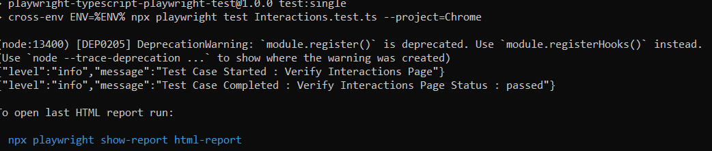

## Análise do Projeto

### Objetivo da Atividade

O objetivo desta atividade foi analisar um framework de automação de testes desenvolvido com Playwright e TypeScript, identificando sua estrutura, principais tecnologias utilizadas e boas práticas empregadas na automação de testes.

### Evidência da Execução

A imagem abaixo demonstra a execução bem-sucedida de um teste automatizado utilizando o Playwright. O cenário **"Verify Interactions Page"** foi executado com sucesso no navegador Chrome.

  

  <i>Figura 1 - Execução de um teste automatizado utilizando Playwright.</i>

### Estrutura do Projeto

Durante a análise foi possível identificar os principais componentes do framework:

- **tests/**: contém os cenários de testes automatizados.
- **pageFactory/pageRepository/**: implementa o padrão Page Object Model (POM).
- **utils/**: reúne funções auxiliares reutilizáveis.
- **lib/**: contém bibliotecas e configurações utilizadas pelo framework.
- **.github/**: armazena os fluxos de integração contínua utilizando GitHub Actions.

### Tecnologias Utilizadas

- Playwright
- TypeScript
- Node.js
- GitHub Actions
- Docker
- SonarQube
- Lighthouse

### Aprendizados Obtidos

Durante a atividade foi possível compreender:

- A estrutura de um projeto profissional de automação de testes.
- A utilização do padrão Page Object Model para organização do código.
- A execução de testes automatizados com Playwright.
- O funcionamento da integração contínua utilizando GitHub Actions.
- O uso de ferramentas auxiliares para qualidade e monitoramento do projeto.

### Conclusão

O projeto analisado apresenta uma estrutura organizada e aderente às boas práticas de automação de testes. A combinação de Playwright, TypeScript e integração contínua proporciona maior qualidade, confiabilidade e facilidade de manutenção dos testes automatizados.
